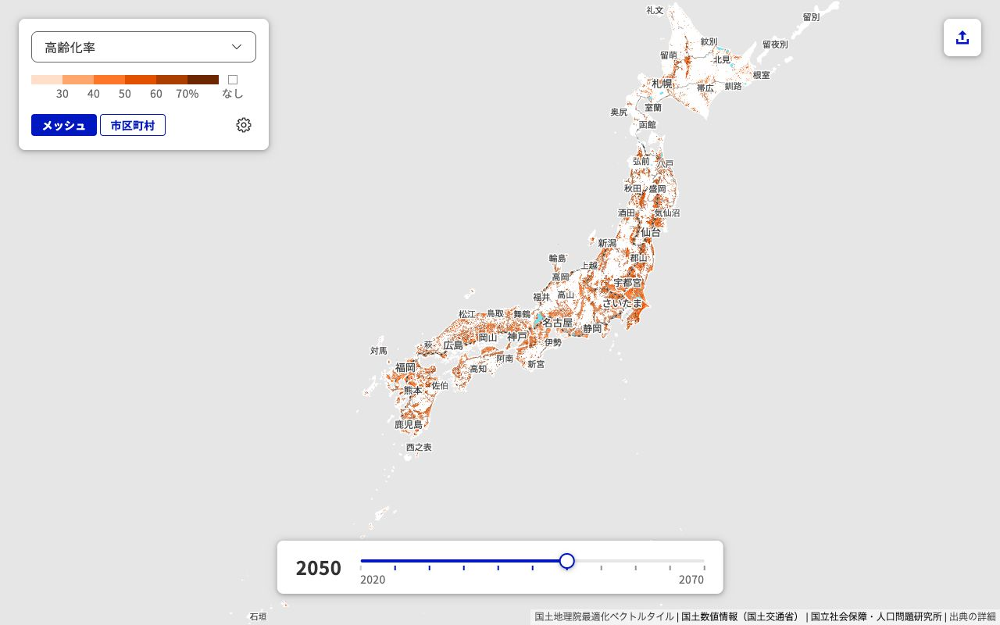
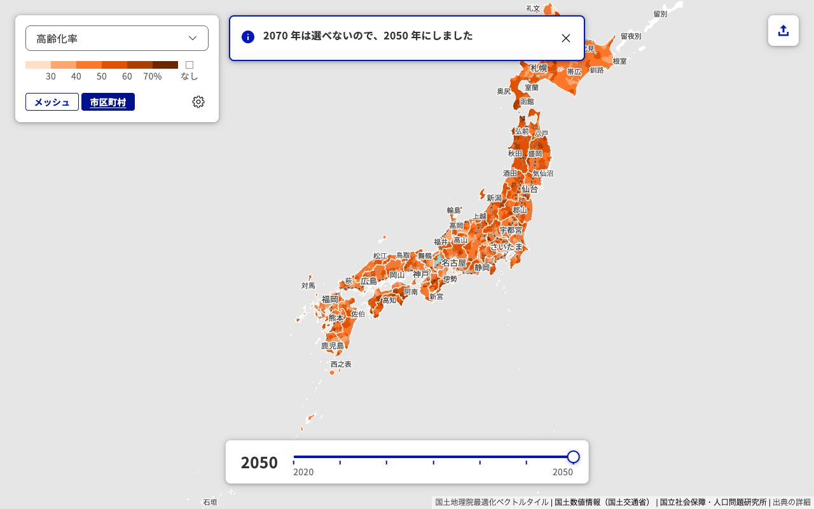
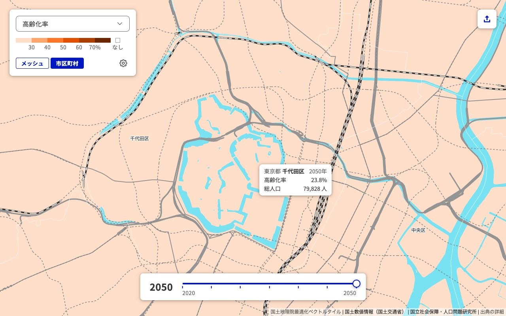
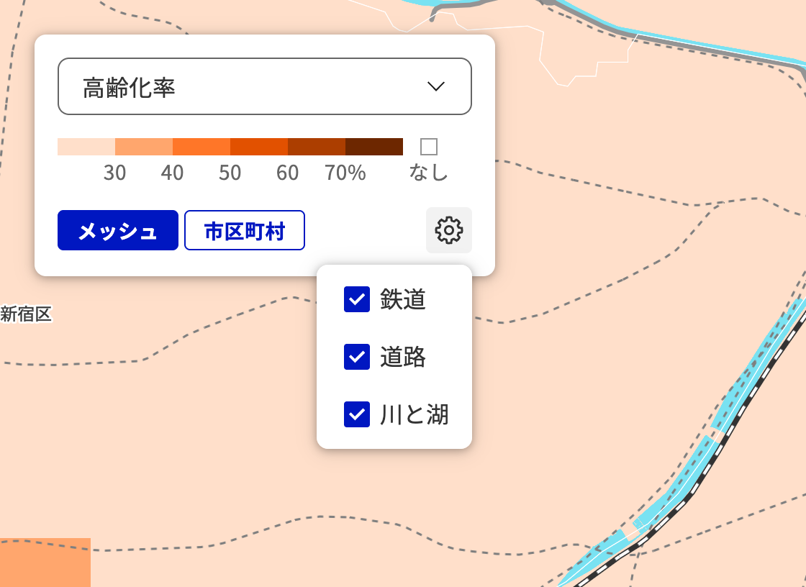
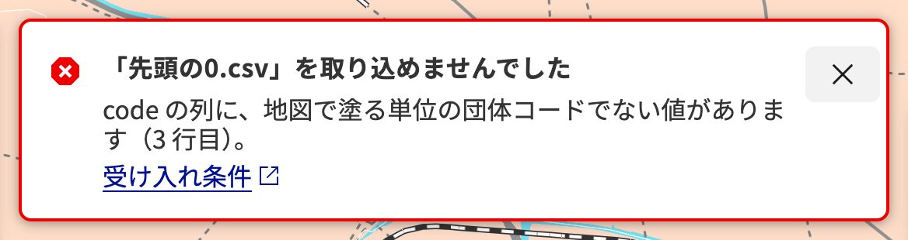
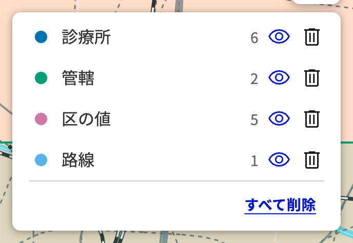

# 使い方

RightsizingJPMap の操作をまとめる。
画面の図は、2026-11-10 に公開中のサイトを Chrome で開いて撮った。
右下のボタン、左下の縮尺、地図の設定の背景地図と塗りの不透明度は 2026-11-24 に足したので、図には写っていない。
左上のパネルの「地域」のボタンと、Ctrl + K の入力欄に出る操作は 2026-11-25 に足したので、これも図には写っていない。

## 画面の構成

地図を画面全体に広げ、その上に操作の部品を重ねている。

常に出ている部品は次の6つである。

- **左上のパネル**：指標の切り替え、凡例、表示する地域（「地域」のボタン）、単位（1km メッシュか市区町村）の切り替え、地図の設定（歯車のボタン）。
- **下の年次のスライダー**：表示する年を選ぶ。
- **右上のボタン**：自前データを追加する。
- **右下のボタン**：拡大と縮小、方位磁石、現在地への移動（「地図を動かす」）。
- **左下の縮尺**：地図の上の距離の目安。
- **右下の出典**：背景地図とデータの提供元（[attribution.md](attribution.md)）。

自前データを1つ以上取り込むと、右上にレイヤーの一覧が加わる。

## 指標と年次を切り替える

左上のパネルで、塗り分ける指標を選ぶ。

- 総人口
- 人口増減率（2025 年比）
- 年少人口（0〜14 歳）
- 生産年齢人口（15〜64 歳）
- 65 歳以上人口
- 75 歳以上人口
- 高齢化率
- 高齢者増加率（2025 年比）

凡例は、色の帯と階級の境目の値を示す。
人口の指標では区切りが指標ごとに決めてあり、年を変えても同じ色は同じ範囲の値を表す。
「なし」の白い四角は、値がないか、年齢別の値が秘匿されている場所の色（透明）を表す（[data-sources.md](data-sources.md) の「メッシュが透明になるとき」）。

単位は、1km メッシュと市区町村のどちらかを選ぶ。
年次のスライダーで選べる年は、単位と指標で異なる（[data-sources.md](data-sources.md) の「年次の範囲」）。
市区町村の推計は 2050 年までなので、2050 年より後の年を選んだまま市区町村に切り替えると、年を 2050 年に合わせ、その旨を表示する。

自前データを取り込むと、その件数と、数値の列の合計も指標に加わる。
自前データの指標は、取り込んだ値をもとに区切る。
自前データの指標を選ぶと、その下に「分母」の選択が現れる。
分母に総人口か年齢別の人口を選ぶと、その人口 1,000 人あたりの値で塗る。
分母の人口には、年次のスライダーで選んだ年の値を使う。

## 地図の上の値を見る

地図の上にマウスのポインタを置くと、その場所の値を示すカードがポインタの横に出る。

- **1km メッシュ**：メッシュコード、選んでいる指標の値、その年の総人口。
- **市区町村**：都道府県と市区町村の名前、選んでいる指標の値、その年の総人口。
- **自前データの点、線、面**：レイヤーの名前と、属性を先頭から5つまで。点は数値の属性だけを出す。

総人口は、比率が極端な値になったときに、人口の少ない場所かどうかを見分けるために添えている。
自前データの指標で、分母に年齢別の人口（65 歳以上人口など）を選んでいるときは、総人口の代わりにその分母の人数を出す。

年齢別の値が秘匿されているメッシュでは値を「秘匿」と出し、値がない場所では「なし」と出す。
塗っていない場所（海など）では、カードは出ない。

カードは、地図をドラッグやズームで動かしているあいだは消え、動き終えてからポインタを動かすとまた出る。
カードはマウスで見るためのもので、クリックで固定したり、キーボードで開いたりすることはできない。

## 地図を動かす

地図は、ドラッグで移動し、マウスのホイールで拡大と縮小をする。
右下のボタンでも操作できる。

- **拡大と縮小**：＋と−のボタンを押す。Shift を押しながらドラッグすると、囲んだ範囲に拡大する。
- **回転**：右ボタンを押しながらドラッグするか、Ctrl を押しながらドラッグする。方位磁石のボタンをドラッグしても回転する。
- **北を上に戻す**：方位磁石のボタンを押す。方位磁石の針は、いまの北の向きを指す。
- **現在地への移動**：現在地のボタンを押すと、ブラウザが位置情報を使ってよいか尋ねる。許可すると、地図が現在地へ移動し、現在地に青い点が出る。許可しなければ、地図は動かない。

現在地は、ボタンを押したときに1回だけ求め、そのあとは追い続けない。
位置は地図を動かすことだけに使い、このアプリからはどのサーバーにも送らない。
位置を求める方法は、ブラウザと OS が決める。

地図にフォーカスがあるときは、キーボードでも操作できる。
矢印キーで移動し、＋と−で拡大と縮小をし、Shift を押しながら左右の矢印キーで回転する。

地図を傾けることはできない。

### 地図の位置を URL で共有する

地図を動かすと、アドレスバーの URL の末尾が `#map=11.5/36.2381/137.972` のように変わる。
数は順に、ズーム、中心の緯度、中心の経度である。
地図を回転させているときは、4つめに向き（北から時計回りの角度）が続く。

この URL を開くと、同じ位置と向きの地図が開く。
URL に載るのは、位置と向きと、表示する地域（「表示する地域を都道府県に絞る」）だけである。
指標、年次、単位、取り込んだデータは載らない。
範囲の外の値など、読めない位置の URL を開いたときは、日本の全体を映す。

## 表示する地域を都道府県に絞る

左上のパネルの「地域：全国」のボタンを押すと、47 都道府県のチェックボックスがパネルの右に開く。
都道府県を選ぶと、選んだ都道府県だけを塗り、地図がその範囲に移動する。
複数の都道府県を選べる。
「全国に戻す」を押すか、すべてのチェックを外すと、全国の表示に戻る。

選んだ都道府県は、URL の末尾に `#pref=19,20` のように載る。
数は都道府県のコード（01 の北海道から 47 の沖縄県まで）で、複数のときはカンマで区切る。
この URL を開くと、はじめからその都道府県だけを読み込んで描く。
全国を描くと動きが重いパソコンでは、この URL をブックマークしておくとよい。
1km メッシュで最初に読み込む量は、全国ではおよそ 1.3MB、長野県だけならおよそ 70KB である（2026-11-25 に開発用のサーバーで測った）。

- **1km メッシュ**：その都道府県の市区町村にかかるメッシュを塗る。県境をまたぐメッシュは、どちらの都道府県を選んでも塗る。値はメッシュ全体の人口から計算したもので、全国の表示と同じである。
- **市区町村**：その都道府県の市区町村だけを塗る。
- **自前データ**：点、線、面のレイヤーは絞らず、すべて表示する。自前データを結合した指標は、選んだ都道府県の分だけを塗り、凡例の区切りも選んだ都道府県の値から作る。
- **ホバーのカード**：塗っていないメッシュと市区町村には出ない。

人のいないメッシュは、どの都道府県のものかを決められないので、都道府県を選んでいるあいだは塗らない。
自前データを 1km メッシュに結合した指標で、人のいないメッシュに値があるときに違いが出る。

`#pref=20,48` のように、都道府県のコードでないものを含む URL を開いたときは、全国を表示する。

## 地図の設定を変える

左上のパネルの歯車のボタンを押すと、地図の設定がパネルの右に開く。
背景地図、重ねるもの、塗りの不透明度の3つを選べる。

図は、背景地図と塗りの不透明度を足す前の設定である。

はじめは、既定の背景地図に、鉄道、道路、川と湖、地名をすべて重ね、塗りは不透明である。
ページを読み込み直すと、この状態に戻る。
設定は、Esc、歯車のボタン、設定の外を押すと閉じる。

### 背景地図

塗り分けの下に敷く地図を、次の6つから選ぶ。

| 名前 | 中身 | 提供元 |
|---|---|---|
| 既定 | 陸を白、海を灰色で塗っただけの地図 | 国土地理院（最適化ベクトルタイル） |
| 写真 | 空中写真と衛星画像 | 国土地理院（地理院タイル） |
| 淡色地図 | 色を抑えた地図。道路、鉄道、地名、等高線を含む | 国土地理院（地理院タイル） |
| 標準地図 | 地理院地図の標準の地図 | 国土地理院（地理院タイル） |
| 色別標高図 | 標高を色で表し、陰影を付けた地図 | 国土地理院（地理院タイル） |
| OpenStreetMap | OpenStreetMap の標準の地図 | OpenStreetMap |

右下の出典は、選んだ背景地図の提供元に変わる。

色別標高図は、日本とその周りだけを描く。
OpenStreetMap の地図は、寄付で運用されているサーバーから読む。
このサーバーは動き続ける保証をしていないので、読めなくなることがある。

### 重ねるもの

背景地図の上に、鉄道、道路、川と湖、地名をそれぞれ重ねるかどうかを選べる。
重ねた線と地名は、塗り分けの上に描かれる。

淡色地図、標準地図、OpenStreetMap は、線と地名を地図の画像の中に持つ。
この3つを選んでいるあいだは、4つとも重ねず、チェックボックスは選べなくなる。
写真を選んでいるあいだは、川と湖だけを重ねない。
写真に水面が写っているからである。
選べなくなったチェックボックスの設定は残り、背景地図を戻すと元のとおりに重なる。

### 塗りの不透明度

塗り分け（メッシュと市区町村の塗り）の濃さを、100%、70%、40% の3つから選ぶ。
100% の塗りは不透明で、塗った場所の背景地図は見えない。
70% と 40% では、塗りを透かして背景地図が見える。

塗りを透かすと、塗りの色が背景地図の色と混ざり、凡例の色と一致しなくなる。
写真と色別標高図の上では、階級を読み違えやすい。
階級を読み取るときは、100% に戻すか、ポインタを乗せて値を確かめる。

自前データのレイヤーの濃さは変わらない。

## 自前データを追加する

ファイルを地図の上にドロップするか、右上のボタンから選ぶ。
受け入れ条件（[acceptance.md](acceptance.md)）を満たすファイルは、そのままレイヤーとして地図に現れる。

条件を満たさないファイルは取り込まず、満たさなかった条件と、行や地物の番号を示す。
「受け入れ条件」のリンクから、条件の説明を開ける。

50MB を超えるファイルは、取り込みに時間がかかることがある旨を表示してから取り込む。

ファイルの中身は、ブラウザの中だけで処理し、サーバーには送らない。

## レイヤーを操作する

レイヤーの一覧では、名前の右に点、線、面、行の件数を示す。
レイヤーごとに次の操作ができる。

- 色の変更（左の色の点を押し、8色の候補から選ぶ）
- 表示と非表示の切り替え（目のボタン）
- 削除（ごみ箱のボタン）

データが2つ以上あるときは、レイヤーの一覧の下にある「すべて削除」で、すべてのデータをまとめて削除できる。
削除したデータは元に戻せないので、削除する前に確かめる。

## 取り込んだデータの保存

取り込んだデータは、色や表示の切り替えとともにブラウザの中に保存し、ページを読み込み直しても残る。
ブラウザの容量が足りなくなると、ブラウザの判断で消されることがある。
プライベートブラウズなど、保存できない環境では、読み込み直すとデータが消える。
どちらの場合も、画面にその旨を表示する。

同じブラウザで2つ以上のタブを開くと、2つめ以降のタブではデータの追加と削除ができない。
保存済みのデータの表示はできる。
最初のタブを閉じると、ほかのタブでも追加と削除ができるようになる。

## 場所へ移動する

Ctrl（macOS では Command）+ K で入力欄を開き、都道府県名や市区町村名の一部を入れると、候補が出る。
候補を選ぶと、地図がその範囲に移動する。
Esc で入力欄を閉じる。

この入力欄からは、操作も呼べる。
何も入れていないときと、「地域」や「絞る」のように操作の名前の一部を入れたときに、「表示する都道府県を選ぶ」が候補に出る。
選ぶと、都道府県のチェックボックスが開く（「表示する地域を都道府県に絞る」）。

同じ名前の市区町村（府中市、伊達市など）は、候補に添えられる都道府県名で見分ける。
読み仮名での検索はできない。
都道府県のように離島を含む範囲へ移動すると、海が広く映ることがある。
地図を回転させているときは、向きを変えずに移動する。

## 接続する外部のサーバー

ブラウザは、画面を表示するときと、データを取り込むときに、次のサーバーに接続する。
取り込んだファイルの中身は、ブラウザの中だけで処理し、どのサーバーにも送らない。

- **GitHub Pages**（oxon-1011.github.io）：アプリ、人口の推計、行政区域のデータ
- **国土地理院**（cyberjapandata.gsi.go.jp）：背景の地図。写真、淡色地図、標準地図、色別標高図は、選んでいるあいだだけ読み込む
- **OpenStreetMap**（tile.openstreetmap.org）：背景地図に OpenStreetMap を選んでいるあいだだけ、地図の画像を読み込む
- **Google Fonts**（fonts.googleapis.com、fonts.gstatic.com）：文字のフォント（Noto Sans JP）。表示した文字を含むファイルだけを読み込む
- **DuckDB**（extensions.duckdb.org）：点のデータを市区町村に割り当てるときに、図形を扱う拡張機能を読み込む
