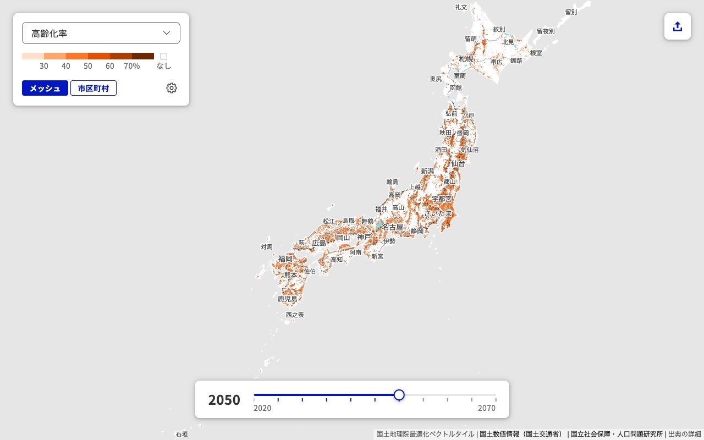
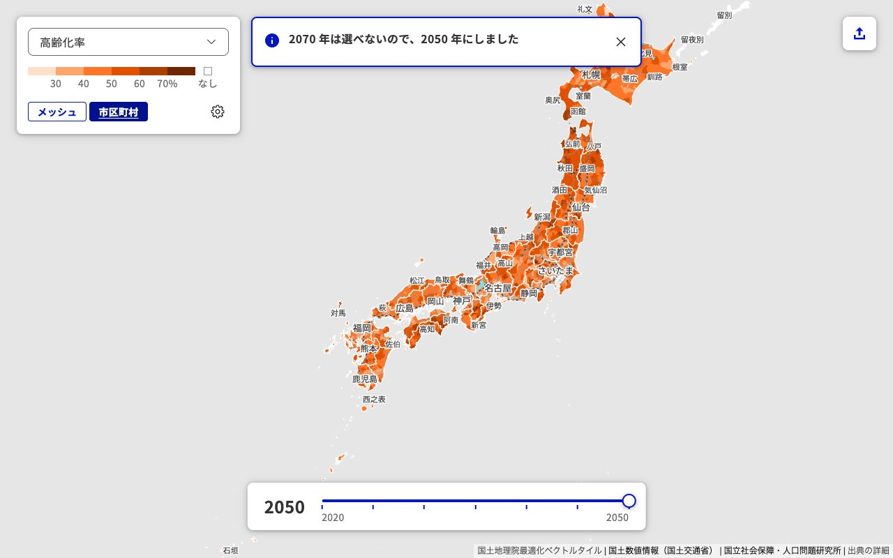
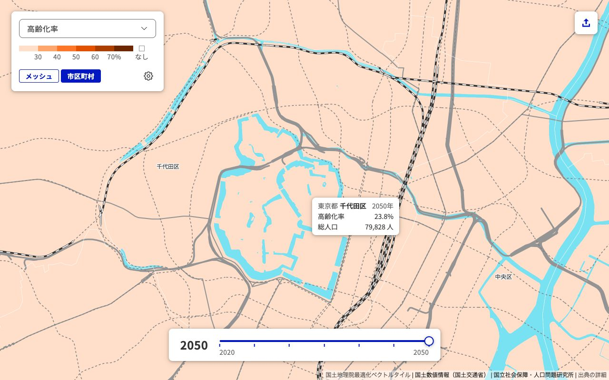
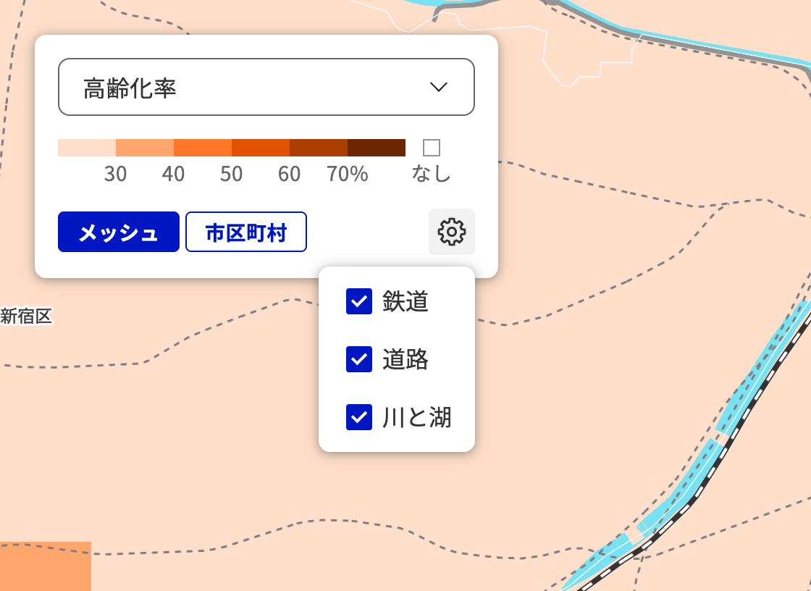
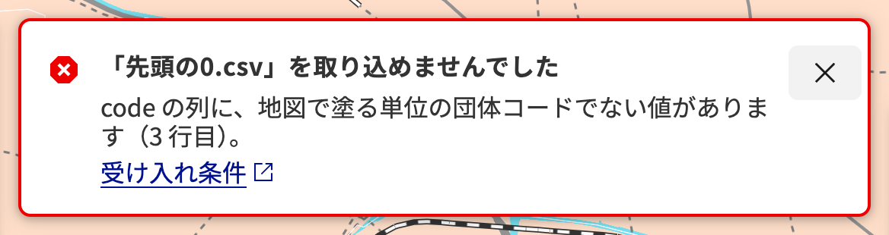
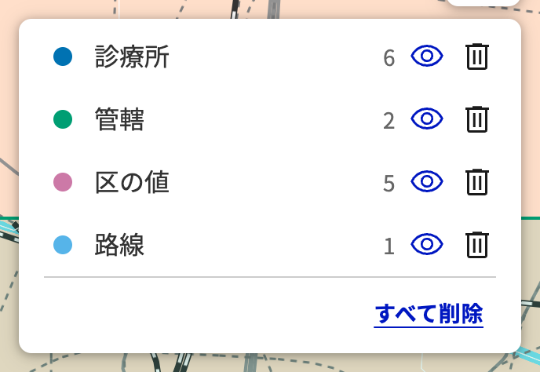

# 使い方

RightsizingJPMap の操作をまとめる。
画面の図は、2026-11-10 に公開中のサイトを Chrome で開いて撮った。

## 画面の構成

地図を画面全体に広げ、その上に操作の部品を重ねている。

常に出ている部品は次の4つである。

- **左上のパネル**：指標の切り替え、凡例、単位（1km メッシュか市区町村）の切り替え、背景地図の設定（歯車のボタン）。
- **下の年次のスライダー**：表示する年を選ぶ。
- **右上のボタン**：自前データを追加する。
- **右下の出典**：データの提供元（[attribution.md](attribution.md)）。

自前データを1つ以上取り込むと、右上にレイヤーの一覧が加わる。

## 指標と年次を切り替える

左上のパネルで、塗り分ける指標を選ぶ。

- 総人口
- 人口増減率（2025 年比）
- 年少人口（0〜14 歳）
- 生産年齢人口（15〜64 歳）
- 65 歳以上人口
- 75 歳以上人口
- 高齢化率
- 高齢者増加率（2025 年比）

凡例は、色の帯と階級の境目の値を示す。
人口の指標では区切りが指標ごとに決めてあり、年を変えても同じ色は同じ範囲の値を表す。
「なし」の白い四角は、値がないか、年齢別の値が秘匿されている場所の色（透明）を表す（[data-sources.md](data-sources.md) の「メッシュが透明になるとき」）。

単位は、1km メッシュと市区町村のどちらかを選ぶ。
年次のスライダーで選べる年は、単位と指標で異なる（[data-sources.md](data-sources.md) の「年次の範囲」）。
市区町村の推計は 2050 年までなので、2050 年より後の年を選んだまま市区町村に切り替えると、年を 2050 年に合わせ、その旨を表示する。

自前データを取り込むと、その件数と、数値の列の合計も指標に加わる。
自前データの指標は、取り込んだ値をもとに区切る。
自前データの指標を選ぶと、その下に「分母」の選択が現れる。
分母に総人口か年齢別の人口を選ぶと、その人口 1,000 人あたりの値で塗る。
分母の人口には、年次のスライダーで選んだ年の値を使う。

## 地図の上の値を見る

地図の上にマウスのポインタを置くと、その場所の値を示すカードがポインタの横に出る。

- **1km メッシュ**：メッシュコード、選んでいる指標の値、その年の総人口。
- **市区町村**：都道府県と市区町村の名前、選んでいる指標の値、その年の総人口。
- **自前データの点、線、面**：レイヤーの名前と、属性を先頭から5つまで。点は数値の属性だけを出す。

総人口は、比率が極端な値になったときに、人口の少ない場所かどうかを見分けるために添えている。
自前データの指標で、分母に年齢別の人口（65 歳以上人口など）を選んでいるときは、総人口の代わりにその分母の人数を出す。

年齢別の値が秘匿されているメッシュでは値を「秘匿」と出し、値がない場所では「なし」と出す。
塗っていない場所（海など）では、カードは出ない。

カードは、地図をドラッグやズームで動かしているあいだは消え、動き終えてからポインタを動かすとまた出る。
カードはマウスで見るためのもので、クリックで固定したり、キーボードで開いたりすることはできない。

## 背景地図の表示を切り替える

左上のパネルの歯車のボタンを押すと、背景地図の設定が開く。
鉄道、道路、川と湖をそれぞれ表示するかどうか選べる。

はじめは3つとも表示しており、ページを読み込み直すと3つとも表示に戻る。
設定は、Esc、歯車のボタン、設定の外を押すと閉じる。

## 自前データを追加する

ファイルを地図の上にドロップするか、右上のボタンから選ぶ。
受け入れ条件（[acceptance.md](acceptance.md)）を満たすファイルは、そのままレイヤーとして地図に現れる。

条件を満たさないファイルは取り込まず、満たさなかった条件と、行や地物の番号を示す。
「受け入れ条件」のリンクから、条件の説明を開ける。

50MB を超えるファイルは、取り込みに時間がかかることがある旨を表示してから取り込む。

ファイルの中身は、ブラウザの中だけで処理し、サーバーには送らない。

## レイヤーを操作する

レイヤーの一覧では、名前の右に点、線、面、行の件数を示す。
レイヤーごとに次の操作ができる。

- 色の変更（左の色の点を押し、8色の候補から選ぶ）
- 表示と非表示の切り替え（目のボタン）
- 削除（ごみ箱のボタン）

データが2つ以上あるときは、レイヤーの一覧の下にある「すべて削除」で、すべてのデータをまとめて削除できる。
削除したデータは元に戻せないので、削除する前に確かめる。

## 取り込んだデータの保存

取り込んだデータは、色や表示の切り替えとともにブラウザの中に保存し、ページを読み込み直しても残る。
ブラウザの容量が足りなくなると、ブラウザの判断で消されることがある。
プライベートブラウズなど、保存できない環境では、読み込み直すとデータが消える。
どちらの場合も、画面にその旨を表示する。

同じブラウザで2つ以上のタブを開くと、2つめ以降のタブではデータの追加と削除ができない。
保存済みのデータの表示はできる。
最初のタブを閉じると、ほかのタブでも追加と削除ができるようになる。

## 場所へ移動する

Ctrl（macOS では Command）+ K で入力欄を開き、都道府県名や市区町村名の一部を入れると、候補が出る。
候補を選ぶと、地図がその範囲に移動する。
Esc で入力欄を閉じる。

同じ名前の市区町村（府中市、伊達市など）は、候補に添えられる都道府県名で見分ける。
読み仮名での検索はできない。
都道府県のように離島を含む範囲へ移動すると、海が広く映ることがある。

## 接続する外部のサーバー

ブラウザは、画面を表示するときと、データを取り込むときに、次のサーバーに接続する。
取り込んだファイルの中身は、ブラウザの中だけで処理し、どのサーバーにも送らない。

- **GitHub Pages**（oxon-1011.github.io）：アプリ、人口の推計、行政区域のデータ
- **国土地理院**（cyberjapandata.gsi.go.jp）：背景の地図
- **Google Fonts**（fonts.googleapis.com、fonts.gstatic.com）：文字のフォント（Noto Sans JP）。表示した文字を含むファイルだけを読み込む
- **DuckDB**（extensions.duckdb.org）：点のデータを市区町村に割り当てるときに、図形を扱う拡張機能を読み込む
